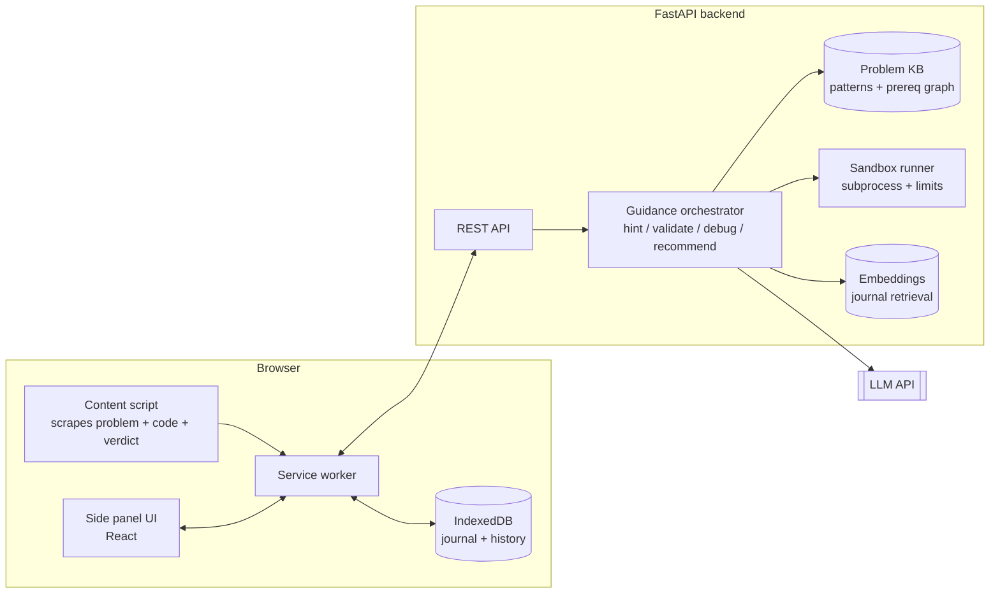

# Unstuck

**A hint-first AI mentor for LeetCode. It doesn't solve the problem for you. It makes you able to solve the next one yourself.**

Unstuck is a browser extension that sits beside LeetCode and gives the smallest amount of help needed to get you moving again. It validates *your* approach, proves when it's wrong with a real failing input, helps you debug, recommends what to practice first, and remembers what you learned.

---

## The problem

Developers can get a full solution from an AI in seconds, but they often can't solve a similar problem a week later.

| Pain | What goes wrong today |
|---|---|
| Solution dependency | AI dumps complete code, so you skip the thinking. |
| Ineffective hints | LeetCode hints are the same for everyone, too vague or too advanced. |
| No approach validation | You spend an hour on an approach that can't work. |
| Missing prerequisites | You attempt a Hard before learning the pattern from the Easy. |
| Debugging pain | Overflow, off-by-one, and TLE are hard to diagnose alone. |
| Poor retention | You forget the reasoning and the failed attempts. |

**Core problem:** existing workflows help you *get* solutions, not *develop* the reasoning to find them.

## The principle

> Give the smallest amount of help needed to get the user moving again.
> Never punish a different valid solution.

---

## Features

### 1. Progressive hint engine
Four levels. The user controls escalation. It never auto-reveals, and it remembers which hints were already shown.

| Level | Name | What you get |
|---|---|---|
| 1 | Nudge | A question that points the right way. |
| 2 | Direction | The pattern or data structure, no algorithm. |
| 3 | Strategy | Key steps and state to maintain, no code. |
| 4 | Walkthrough | Pseudocode or a traced example. Full code only on explicit request. |

### 2. Approach validation
Judges your actual approach, not a single reference solution.

- **Valid:** encouraged to continue.
- **Valid but inefficient:** complexity vs. the problem's constraints, with the optimization offered only if needed.
- **Fundamentally flawed:** the precise logical gap, with a chance to fix it.

### 3. Verified counterexamples (the hero feature)
Before claiming "your approach is wrong," Unstuck proves it.

1. The LLM writes a brute-force solution and a small-input generator from the problem statement.
2. The brute force is sanity-checked against the problem's given examples. If it fails, regenerate or say "couldn't verify."
3. Your code and the brute force run on random small inputs in a sandbox.
4. The first mismatch is shrunk to a **minimal failing input** and shown: input, expected, yours.

This is what separates Unstuck from "ask ChatGPT." The claim is checked by execution, not just asserted.

### 4. Prerequisite and pattern recommendations
- Each problem is mapped to patterns and prerequisite concepts.
- A skill profile is built from solved history and hint usage.
- Recommends a short, targeted path (Easy to Medium to back to the original), as a suggestion and never a gate.
- Explains the link: "Same sliding-window idea as before, now with character frequencies."

### 5. Guided debugging
Interprets the *actual* result (compile error, runtime error, wrong answer, TLE) instead of guessing.

- Compile and runtime errors: explains the message and points at the line of thinking.
- Integer overflow: spots boundary values like `-2147483648` and asks the right question.
- Wrong answer: guides toward the edge case (empty, duplicates, negatives, boundaries).
- TLE: complexity analysis against constraints.
- After you fix it, explains *why* the fix works.

### 6. Coding journal
After solving, a short reflection: approach used, reasoning, obstacle faced, takeaway in your own words. Also stores hints used, complexity, and failed approaches. A journal entry is reviewed by the AI for correctness.

When you hit a similar problem later, the relevant entry resurfaces.

---

## Extra features (beyond the core idea)

| Feature | Why it's worth it |
|---|---|
| **Constraint reader** | Parses `n <= 10^5` and tells you which complexities are feasible. Kills dead ends in seconds. |
| **Rubber-duck mode** | You explain your plan in words *before* coding. It asks questions instead of answering. |
| **Hint budget** | Optional daily or per-problem hint cap, so you decide how much help you want. |
| **"Why not X?" mode** | Ask why an alternative (greedy, sort, BFS) fails. Backed by a counterexample when possible. |
| **Spaced revisit** | Resurfaces solved problems on a 1/3/7/21-day schedule and gives a *similar* problem, not the same one. |
| **Pattern map** | A visual graph of patterns you've mastered, shaky, or never touched. |
| **Hint-dependence score** | Tracks hints per problem over time. Goal: the number trends down. |
| **Interview mode** | Timed session, no hints beyond Level 2, post-session feedback on communication and complexity analysis. |
| **Local-first and BYO key** | Journal stays on-device by default. Users can bring their own API key. |

---

## How it works (user journey)

```
Open problem -> readiness check -> attempt -> ask for hint / check approach
     -> counterexample or debug help -> solve -> journal -> spaced revisit
```

1. Extension detects the problem and its patterns.
2. Checks your history. Weak prerequisites trigger a *suggestion*, not a block.
3. You attempt it. Click **Hint**, **Check my approach**, or **Explain error**.
4. If your code fails, **Break my code** finds a minimal counterexample.
5. After solving, the journal prompt opens.
6. Later, similar problems surface the entry, and revisit reminders appear.

---

## Architecture



---

## Tech stack

### Extension
| Piece | Choice | Why |
|---|---|---|
| Platform | Chrome Extension, **Manifest V3** | Side panel API, widest reach. |
| Language | **TypeScript** | Scraping code breaks quietly, so types help. |
| UI | **React + Tailwind** | Fast side-panel UI. |
| Build | **Vite + CRXJS** | Hot reload for extensions. |
| State | **Zustand** | Small and simple. |
| Local storage | **IndexedDB** (via Dexie) | Local-first journal, hints seen, settings. |
| Scraping | One isolated `leetcode-adapter.ts` module | LeetCode's DOM will change. Contain the damage in one file. |
| Editor access | Read from the page's Monaco editor | Gets live code without private APIs. |

### Backend
| Piece | Choice | Why |
|---|---|---|
| Framework | **FastAPI (Python)** | Async, typed with Pydantic, and the sandbox runs Python natively. |
| LLM | **OpenAI API** behind the backend, with a separate prompt per mode | Keeps the key off the client. Structured outputs for hints and diagnoses. |
| Prompting | Per-mode system prompts, JSON schema outputs | Hint, validate, debug, recommend and review each have a different contract. |
| DB | **SQLite** for the MVP, **Postgres** later | Zero setup now, easy migration. |
| Retrieval | **sentence-transformers** with `sqlite-vec` (pgvector later) | Surface similar past journal entries. |
| Problem KB | Curated JSON: ~150 problems (NeetCode 150) with pattern tags, difficulty, prerequisite edges | Small, accurate, and hand-checked beats big and noisy. |
| Auth | Local token for MVP, OAuth later | Don't build auth in a sprint. |

### Code execution (counterexample finder)
| Piece | Choice | Why |
|---|---|---|
| Runner | Python `subprocess` with **timeout, memory limit (`resource`), no network** | Good enough for local MVP. |
| Hardening (post-MVP) | **Docker** or **nsjail/gVisor** | Required before any public deployment. |
| Alternative | **Pyodide** in a sandboxed extension page | No backend execution, but heavier to wire up under MV3. |
| Shrinking | Custom delta-debugging on the failing input | Produces the *minimal* counterexample. |

### Dev and quality
- **pytest** for backend, **Vitest** for extension.
- **Ruff + ESLint/Prettier**.
- **GitHub Actions** for lint and tests.
- **Eval set:** 20 problems with known-wrong solutions to measure whether verified counterexamples actually fire.

---

## Data model (core tables)

```
users(id, settings)
problems(slug, title, difficulty, patterns[], prereqs[])
attempts(id, user_id, slug, code_snapshot, verdict, hints_used, ts)
hints_seen(attempt_id, level, ts)
journal(id, user_id, slug, approach, reasoning, obstacle, takeaway, complexity, ts)
skills(user_id, pattern, strength, last_seen)
revisits(user_id, slug, due_at, interval_days)
```

---

## MVP scope (build this first)

- [ ] Side panel with **Hint**, **Check my approach**, **Explain error**
- [ ] Progressive hint engine (4 levels, user-controlled)
- [ ] Approach validation with complexity vs. constraints
- [ ] **Counterexample finder** (the demo-winning piece)
- [ ] Journal (save approach, mistake, complexity, takeaway)
- [ ] Small curated pattern and prerequisite map (about 50 problems to start)

**Start with paste-in:** let the user paste code or the error. Add automatic scraping once the core experience works.

**Defer:** profile import, spaced revisit, pattern map, interview mode, multi-language support.

For a 5-hour sprint, cut it to: side panel, hint ladder, counterexample finder. That trio is the demo.

---

## Roadmap

| Phase | Adds |
|---|---|
| v0.1 | Hint ladder, approach check, error explainer (paste-in) |
| v0.2 | Counterexample finder, constraint reader |
| v0.3 | Journal, local storage, journal review |
| v0.4 | Prerequisite recommender, skill profile |
| v0.5 | Spaced revisit, journal retrieval on similar problems |
| v1.0 | Pattern map, interview mode, hardened sandbox |

---

## Risks and how we handle them

| Risk | Mitigation |
|---|---|
| LeetCode DOM or ToS changes | One adapter module. Read and advise only. No auto-submit, no private endpoints. |
| LLM gives wrong guidance on Hards | Ground every response in constraints, code, and test results. Verify claims with the counterexample runner. Say "couldn't verify" honestly. |
| Unsafe code execution | Local-only for MVP, subprocess limits, no network. Container sandbox before any public release. |
| Privacy of code and journals | Local-first storage, minimal data sent, clear explanation of what is stored, delete-all button. |
| Users just click through to Level 4 | Hint budget, a "what have you tried?" prompt before Level 4, and the hint-dependence score. |

---

## Measuring success

Not "problems solved." Measure independence.

- **Hint efficiency:** hints needed before meaningful progress.
- **Independent completion:** solving a *similar* problem days later without the full solution.
- **Pattern retention:** recognizing a learned pattern in a new problem.
- **Debugging improvement:** fewer error-explanation requests per problem over time.
- **Journal quality:** entries with correct reasoning, not copied explanations.

**Best experiment:** give users a similar problem 3 to 7 days after the original and compare how independently they solve it.

---

## Pitch

**Problem:** Developers rely on AI-generated solutions that give correct answers but weak independent reasoning, debugging skill, and retention.

**Solution:** A browser extension that acts as a personalized AI coding mentor inside LeetCode. It gives progressive, context-aware hints, validates your own approach, proves flaws with verified counterexamples, guides debugging, recommends prerequisites, and keeps a reflective journal that powers future revision.

**Differentiator:** Everyone else gives you the answer. Unstuck *verifies* where you're wrong, gives you the least help you need, and remembers what you learned.

---

## Pillars

1. **Guide me:** progressive hints, approach validation, verified counterexamples.
2. **Teach me:** debugging explanations, prerequisite-based practice.
3. **Help me remember:** journal, spaced revisit, pattern recognition.

## Getting started (Chrome extension demo)

The current Manifest V3 demo opens in Chrome's side panel. It supports paste-in
problem context and progressive hints. It does not yet read LeetCode pages or include
approach checks, debugging, a journal, or the counterexample interface.

1. Configure `backend/.env` with `OPENAI_API_KEY` and `OPENAI_MODEL` (`gpt-4.1-mini` is
   the selected demo model). Keep the key in the backend only.
2. In one PowerShell window, start the API:

   ```powershell
   cd backend
   .\.venv\Scripts\Activate.ps1
   uvicorn app.main:app --host 127.0.0.1 --port 8000
   ```

3. In Chrome, open `chrome://extensions`, turn on **Developer mode**, choose **Load
   unpacked**, and select this repository's `extension/` folder. Click the Unstuck
   toolbar icon to open the side panel.

4. Paste a problem title and statement into the side panel. The extension sends a hint
   request to the local backend only when you click **Get a hint**. If the API is
   unavailable, it clearly labels its generic sample response as a demo.

Create the backend environment if needed with `python -m venv .venv`, activate it,
then install `pip install -r requirements.txt` from `backend/`.

## License

MIT
